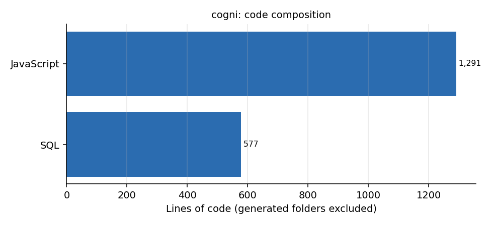

# cogni

**Offline-first mobile app (React Native with Expo) for managing companies, clients and their people, backed by a local SQLite database with a full relational schema.** *Em portugues: aplicativo mobile para cadastro de empresas, clientes e contatos, com banco SQLite local.*

## What is in it

| Part | Content |
|---|---|
| `source/pages/LoginPage.js` | Login |
| `source/pages/cliente/` | Client list, client detail and client registration pages (`ListaClientesPage`, `InfoClientesPage`, `CadastrarClientesPage`) with a `CardClientes` component |
| `source/components/DB.js`, `Database.js` | SQLite access through `expo-sqlite` |
| `DDL Mobile.sql`, `DDL Mobile clean.sql` | The schema: segments (with CNAE), addresses, people, users, profiles and permissions, companies and clients (both with a parent for hierarchies), the join tables between people, addresses and companies or clients, profile photos and logos |
| `ModelosBaseDadosCogni/` | Local database model and JSON templates for create, insert and delete |



## Run

```bash
yarn install            # dependencies are listed in dependencias.txt (expo-sqlite, md5)
npx expo start
```

## Status

The data model is the most developed part (about 570 lines of SQL for 18 tables, with a user, profile and permission model); the client screens and login exist and read from it. Written in Portuguese.
